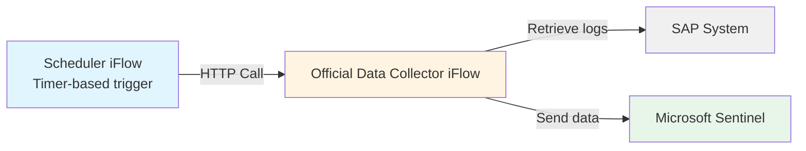
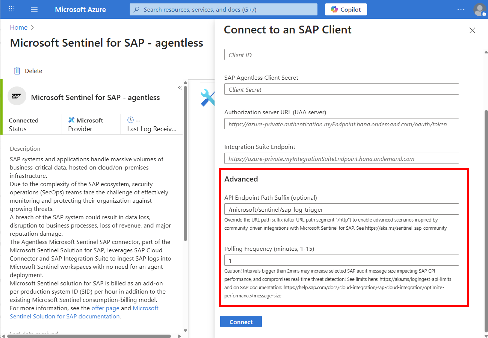

# Release Notes

| **Version** | **Date Modified (DD-MM-YYYY)** | **Comments** |
| --- | --- | --- |
| 1.0.9 | 14-09-2026 | SAP SuccessFactors flow added (Audit Log Service Search API) |
| 1.0.8 | 28-04-2026 | KeyValue map for Data Collector customizing added |
| 1.0.7 | 31-03-2026 | PAHI reader, Scheduler flow added |
| 1.0.6 | 01-12-2025 | SAP Ariba flow added |
| 1.0.5 | 23-10-2025 | SAPControl based integration flow added (AS JAVA) |
| 1.0.4 | 06-10-2025 | ClientCert auth added for S4 public edition |
| 1.0.3 | 07-08-2025 | S/4HANA Cloud Public Edition (GROW) support added |
| 1.0.2 | 30-05-2025 | SOAR - user unblock action added |
| 1.0.1 | 09-05-2025 | ABAP Table Reader scenario release |
| 1.0.0 | 17-04-2025 | SOAR for SAP scenario release |

Pick latest zip file from source or the [releases section](https://github.com/Azure-Samples/Sentinel-For-SAP-Community/releases/latest).

## Configuration hints for artifacts

### Table of Contents

**SAP SaaS apps**

1. [SAP Ariba](#sap-ariba)
1. [SAP SuccessFactors](#sap-successfactors)
1. [SAP S/4HANA Cloud Public Edition (GROW)](#sap-s4hana-cloud-public-edition-grow)
1. [SAP Integrated Business Planning (IBP)](#sap-s4hana-cloud-public-edition-grow) (same steps as GROW using `SAP_COM_0750`)

**Supporting functions**

1. [SOAR - Configure SAP User blocking + Audit Log reactivation](#soar---sap-integration-suite-endpoint-and-rfc-destination-name)
1. [Table Reader - Custom Sentinel tables](#table-reader---custom-sentinel-tables)
1. [PAHI Legacy Reader - Track admin changes](#pahi-legacy-reader---track-admin-changes)
1. [SAPControl based log collector (e.g. AS JAVA)](#sapctrl-log-collector)
1. [Data Collector Scheduler](#data-collector-scheduler)
1. [Data Collector Customizing (Key Value Map)](#data-collector-customizing-key-value-map)
1. [Permissions](#permissions)

### SAP Ariba

This artifact activates the existing Microsoft Sentinel Solution for SAP applications capabilities build for SAP Ariba. The integration approach relies on SAP Ariba's [Audit Search API](https://api.sap.com/api/audit_search_v2/overview).

See [**this blog post**](https://community.sap.com/t5/enterprise-resource-planning-blog-posts-by-members/sap-ariba-is-now-integrated-with-microsoft-sentinel-solution-for-sap/ba-p/14324356) for more details on the integration.

#### Step by step

- Follow SAP's [official documentation](https://help.sap.com/docs/ariba-apis/help-for-sap-ariba-developer-portal/steps-to-start-using-sap-ariba-apis) to get started with the Ariba Audit Search API.

- Configure the iFlow "Send SAP Ariba Audit Logs to Microsoft Sentinel" the same way as described for SAP NetWeaver or private edition [here](https://learn.microsoft.com/azure/sentinel/sap/preparing-sap?pivots=connection-agentless#configure-the-connector-in-microsoft-sentinel-and-in-your-sap-system).

- Create a destination on BTP governing your connection and credential to Ariba. It is a good practice to mention the tenantid and (e.g. Ariba-p2pTeSap-2).

Take note of your destination name for the next steps on Sentinel.

##### Destination configuration example (OAuth)

| **Property** | **Value** | **Description** |
| --- | --- | --- |
| Name | Ariba-[TenantId] | Destination name (e.g., Ariba-p2pTeSap-2) |
| Type | HTTP | Connection type |
| URL | https://[region.]openapi.ariba.com/api/audit-search/v2/[prod or sandbox] | SAP Ariba Audit Search API URL (Find your base URl under [Configuration Details](https://api.sap.com/api/audit_search_v2/overview)) |
| Proxy Type | Internet | Always internet because of the cloud nature of the SAP service |
| Authentication | OAuth2ClientCredentials | For productive use |
| Client ID | [ClientId] | if applicable |
| Client Secret | [ClientSecret] | if applicable |
| Token Service URL | [TokenEndpoint]/v2/oauth/token | Ariba OAuth token endpoint |

| **Additional Properties** | **Value** | **Description** |
| --- | --- | --- |
| tenantId | [TenantId] | SAP Ariba tenant ID |
| apiKey | [apiKey] | Api key for your SAP Ariba tenant |

> [!NOTE]
> For testing purposes with API key from SAP API Business Hub you can also use pure API Key authentication as described below.
>
>| **Property** | **Value** | **Description** |
>| --- | --- | --- |
>| Name | Ariba-[TenantId] | Destination name (e.g., Ariba-p2pTeSap-2) |
>| Type | HTTP | Connection type |
>| URL | https://sandbox.api.sap.com/ariba/api/audit-search/v2/sandbox | SAP Ariba Audit Search API URL (Find your base URl under [Configuration Details](https://api.sap.com/api/audit_search_v2/overview)) |
>| Proxy Type | Internet | Always internet because of the cloud nature of the SAP service |
>| Authentication | BasicAuthentication | For use with APIKey header |
>| User | APIKey | Name of header to be sent |
>| Password | Your API Key | API Key value |

##### Finalize the setup

Follow the [common finalize steps](#finalize-sentinel-onboarding) below, using community API path `/community/SAPAribaAuditSearch`.

### SAP SuccessFactors

This artifact activates the existing Microsoft Sentinel Solution for SAP applications capabilities for SAP SuccessFactors. The integration approach relies on the next-generation (v3) [SAP Audit Log Service (ALS)](https://help.sap.com/docs/AUDIT_LOG_VIEWER/c3f8b96450e443cebbdc9c2d162b86fa/1bbf89116ca842549273a907a7e22241.html) **Search API v1**, which serves audit events of multiple SAP cloud services from a central store. The iFlow offers an option to filter the result set to SuccessFactors-only entries.

#### Step by step

- Follow SAP's [Getting Started With SAP Audit Log Service Search API](https://help.sap.com/docs/AUDIT_LOG_VIEWER/c3f8b96450e443cebbdc9c2d162b86fa/1bbf89116ca842549273a907a7e22241.html) to onboard the service and determine your region-specific Search API base URL and token endpoint.

- Ensure your SuccessFactors instance is connected to the next-generation Audit Log Service so that its audit events are available through the Search API. Consult SAP's [Audit Log Viewer documentation](https://help.sap.com/docs/AUDIT_LOG_VIEWER) for the current service enablement steps.

- Configure the iFlow "Send SAP SuccessFactors audit logs to Microsoft Sentinel" the same way as described for SAP NetWeaver or private edition [here](https://learn.microsoft.com/azure/sentinel/sap/preparing-sap?pivots=connection-agentless#configure-the-connector-in-microsoft-sentinel-and-in-your-sap-system).

- Create a destination on BTP governing your SAP ALS connection (access to SuccessFactors audit logs) and respective credential via the required SAP Cloud Identity Service. It is a good practice to mention the tenant (e.g. ALS-SF-prod).

Take note of your destination name for the next steps on Sentinel.

##### Destination configuration example (OAuth2)

| **Property** | **Value** | **Description** |
| --- | --- | --- |
| Name | ALS-SF-[Tenant] | Destination name (e.g., ALS-SF-prod) |
| Type | HTTP | Connection type |
| URL | https://[als-search-api-host].als.services.cloud.sap/search/v1 | Audit Log Service Search API base URL from your service key (see [Getting Started](https://help.sap.com/docs/AUDIT_LOG_VIEWER/c3f8b96450e443cebbdc9c2d162b86fa/1bbf89116ca842549273a907a7e22241.html)) |
| Proxy Type | Internet | Always internet because of the cloud nature of the SAP service |
| Authentication | OAuth2ClientCredentials | For productive use |
| Client ID | [ClientId] | from [SAP CIS credentials](https://help.sap.com/docs/AUDIT_LOG_VIEWER/c3f8b96450e443cebbdc9c2d162b86fa/83d19cec1ac74bfe9e69e0cede5d0822.html) |
| Client Secret | [ClientSecret] | from [SAP CIS credentials](https://help.sap.com/docs/AUDIT_LOG_VIEWER/c3f8b96450e443cebbdc9c2d162b86fa/83d19cec1ac74bfe9e69e0cede5d0822.html) |
| Token Service URL | https://[sap-cis-domain].accounts.ondemand.com/oauth2/token | OAuth token endpoint from the [ALS documentation](https://help.sap.com/docs/AUDIT_LOG_VIEWER/c3f8b96450e443cebbdc9c2d162b86fa/782e8fad25134207bf14a4f80d9c11b1.html) |
| User | Technical User Name | from [SAP CIS credentials](https://help.sap.com/docs/AUDIT_LOG_VIEWER/c3f8b96450e443cebbdc9c2d162b86fa/83d19cec1ac74bfe9e69e0cede5d0822.html) |
| Password | Technical User Password | from [SAP CIS credentials](https://help.sap.com/docs/AUDIT_LOG_VIEWER/c3f8b96450e443cebbdc9c2d162b86fa/83d19cec1ac74bfe9e69e0cede5d0822.html) |

> [!NOTE]
> The ALS Search API is a shared store across SAP cloud services. Without the SuccessFactors filter you may ingest audit events of other services running in the same subaccount.

##### Finalize the setup

Follow the [common finalize steps](#finalize-sentinel-onboarding) below, using community API path `/community/SAPSFAuditSearch`.

Verify audit log ingest from table `SAP_SFAudit_CL` or your own chosen custom table in Microsoft Sentinel.

```kql
SAP_SFAudit_CL
| take 10
```

### SAP S/4HANA Cloud Public Edition (GROW)

This artifact activates the existing Microsoft Sentinel Solution for SAP applications capabilities build for SAP NetWeaver, RISE, and S/4HANA Cloud. The integration approach relies on communication scenario [SAP_COM_0750](https://help.sap.com/docs/SAP_S4HANA_CLOUD/0f69f8fb28ac4bf48d2b57b9637e81fa/a93dca70e2ce43d19ac93e3e5531e37d.html) for audit log retrieval. Find more details on the semantic mapping [here](https://help.sap.com/docs/sap-btp-abap-environment/abap-environment/retrieving-security-audit-log-e6aa861c1f5e4baa93cba69fa0565353).

> [!NOTE]
> The integration pattern is applicable to SAP IBP as well using [communication scenario `SAP_COM_0750`](https://help.sap.com/docs/SAP_INTEGRATED_BUSINESS_PLANNING/da797ae2bf6246d58abd417f24915d55/f14784c30048406287978167e474c712.html). The same steps apply with the respective scenario and API endpoints.

#### Step by step

- Follow SAP's [official documentation](https://help.sap.com/docs/SAP_S4HANA_CLOUD/0f69f8fb28ac4bf48d2b57b9637e81fa/2e84a10c430645a88bdbfaaa23ac9ff7.html) to activate communication scenarios and apply to `SAP_COM_0750`.

- Configure the iFlow "Send S4HANA Cloud Public Edition security logs to Microsoft Sentinel" the same way as described for SAP NetWeaver or private edition [here](https://learn.microsoft.com/azure/sentinel/sap/preparing-sap?pivots=connection-agentless#configure-the-connector-in-microsoft-sentinel-and-in-your-sap-system).

- Create a destination on BTP governing your connection and credential to S/4HANA Cloud Public Edition. It is a good practice to mention the three character SID and three digit client number (e.g. S4-PC-YKJ-100). Take note of your destination name for the next step.

See [**this blog post**](https://community.sap.com/t5/enterprise-resource-planning-blog-posts-by-members/configure-certificate-auth-for-microsoft-sentinel-with-s-4hana-cloud-public/ba-p/14325596) for more details on the integration.

##### Destination configuration example (Basic Auth)

| **Property** | **Value** | **Description** |
| --- | --- | --- |
| Name | S4-PC-[SID]-[Client] | Destination name (e.g., S4-PC-YKJ-100) |
| Type | HTTP | Connection type |
| URL | https://[tenant]**-api**.s4hana.cloud.sap | S/4HANA Cloud system **API** URL |
| Proxy Type | Internet | Always internet because of the cloud nature of the SAP service |
| Authentication | BasicAuthentication | Authentication methods supported by S/4HANA Cloud public edition |
| User | [Communication User] | if applicable |
| Password | [Password] | if applicable |

##### Destination configuration example (Client Certificate Auth)

The iflow uses the built-in client cert `sap_cloudintegrationcertificate`. You need to upload it to your S/4HANA Cloud Public Edition system and assign it to the communication user attached in arrangement `SAP_COM_0750`.

See SAP's download instructions on SAP note [2660023](https://me.sap.com/notes/2660023). Download the leaf certificate in a compatible format.

| **Property** | **Value** | **Description** |
| --- | --- | --- |
| Name | S4-PC-[SID]-[Client] | Destination name (e.g., S4-PC-YKJ-100) |
| Type | HTTP | Connection type |
| URL | https://[tenant]**-api**.s4hana.cloud.sap | S/4HANA Cloud system **API** URL |
| Proxy Type | Internet | Always internet because of the cloud nature of the SAP service |
| Authentication | ClientCertificateAuthentication | Authentication methods supported by S/4HANA Cloud public edition |
| Key Store Source | ClientProvided | this will be used as trigger for the iflow to use X509 |
| Key Store Location | (empty) | not applicable |
| Key Store Password | (empty) | not applicable |

> [!IMPORTANT]
> sap_cloudintegrationcertificate is supported out-of-the-box for ease of use. For custom Client Certificates learn more from SAP's [blog](https://community.sap.com/t5/enterprise-resource-planning-blog-posts-by-sap/beyond-basic-2-certificate-based-authentication-in-sap-s-4hana-cloud-public/ba-p/13644334) and ensure that the certificate signing authority is trusted by SAP. Find details on [SAP Note 2801396](https://me.sap.com/notes/2801396)

##### Finalize the setup

Follow the [common finalize steps](#finalize-sentinel-onboarding) below, using community API path `/community/SAPS4_Public_Cloud_Security_Audit_Log`.

> [!NOTE]
> Community flows, the official agentless connector, and SAP's S/4HANA Cloud Public Edition connector in Sentinel can coexist without issues. Just ensure that the correct path is used in the connection settings.

### SOAR - SAP Integration Suite endpoint and RFC destination name

There are multiple ways to retrieve the required info for the SAP Integration Suite endpoint and the RFC destination name on SAP BTP for the Sentinel [playbook](https://learn.microsoft.com/azure/sentinel/sap/sap-solution-security-content#available-playbooks). See one inline KQL query example below.

```kql
ABAPAuditLog
| where SystemId == "PM4"
| distinct SystemUniqueId, AgentId
```

### Table Reader - Custom Sentinel tables

DCR-based custom log tables require the target schema to be defined beforehand. Find the instructions [here](https://learn.microsoft.com/azure/azure-monitor/logs/create-custom-table?tabs=azure-portal-1%2Cazure-portal-2%2Cazure-portal-3#create-a-custom-table).

- Get sample json payload for schema generation for your custom SAP table in Sentinel by executing the table reader iFlow.

- Configure the iflow using the newly created Data Collection Endpoint, immutable id of the associated data collection rule, and your custom table name (log analytics stream name). It will look something like this: "Custom-test_rfc_CL". Prefix "Custom-" and suffix "_CL" are required.

- Conclude the exercise by providing access to your data collection rule with role "Monitoring Metrics Publisher" to a service principal. See instructions and prerequisites [here](https://learn.microsoft.com/entra/identity-platform/howto-create-service-principal-portal#option-3-create-a-new-client-secret).

- Now, Run your iFlow to send data to Sentinel.

See [important notes for custom tables](#important-notes-for-custom-tables) regarding duplicate handling.

### PAHI Legacy Reader - Track admin changes

Be aware that former agent-based data collector brought the ABAP_PAHI_CL table by default on deployment. Your extension should use ABAP_PAHI_2_CL to avoid conflicts.

> [!NOTE]
> DCR-based custom log tables require the target schema to be defined beforehand. Find the instructions [here](https://learn.microsoft.com/azure/azure-monitor/logs/create-custom-table?tabs=azure-portal-1%2Cazure-portal-2%2Cazure-portal-3#create-a-custom-table).

- Get sample json payload for schema generation for your SAP PAHI table in Sentinel by executing the legacy reader iFlow -> copy from iflow trace http step pointing at Sentinel.

- Configure the iflow using the newly created Data Collection Endpoint, immutable id of the associated data collection rule, and your custom table name (log analytics stream name). It will look like this: "Custom-ABAP_PAHI_2_CL". Prefix "Custom-" and suffix "_CL" are required.

- Conclude the exercise by providing access to your data collection rule with role "Monitoring Metrics Publisher" to a service principal. See instructions and prerequisites [here](https://learn.microsoft.com/entra/identity-platform/howto-create-service-principal-portal#option-3-create-a-new-client-secret).

- Adjust the provided legacy parser/function `SAP_PAHI` to work across both your new and the old table. The function is available in the [parser folder](../../parser/) and should be deployed as custom function in Sentinel. It unifies the new and old PAHI tables into a single schema for ease of use in analytics and hunting.

- Save the new function named `SAP_PAHI` from the Log Analytics workspace query editor using the "Save" button and override if needed.

- Now, Run your iFlow to send data to Sentinel, browse the new custom table using the function. 

- Finalize by deploying the analytic rule `Monitor the configuration of static SAP security parameters`. Learn more about the rule and monitored parameters [here](https://learn.microsoft.com/en-us/azure/sentinel/sap/sap-solution-security-content?pivots=connection-agent#monitor-the-configuration-of-static-sap-security-parameters-preview).

See [important notes for custom tables](#important-notes-for-custom-tables) regarding duplicate handling.

### SAPCtrl log collector

This integration flow uses SAP Integration Suite's built-in capabilities to connect to SAPControl-based interface. It is suitable for security audit logs of AS JAVA systems, SAP ICM, or other log files accessible via SAPControl. See SAP's documentation for [Security Audit Log of the AS Java](https://help.sap.com/docs/SAP_NETWEAVER_750/1531c8a1792f45ab95a4c49ba16dc50b/4b6013583840584ae10000000a42189c.html), the official [SAP Note 221257](https://me.sap.com/notes/2212573) for reference. Consider also SAP's supportability note [3399302 ](https://me.sap.com/notes/0003399302) regarding older NetWeaver versions.

#### Destination configuration example

| **Property** | **Value** | **Description** |
| --- | --- | --- |
| Name | PO-[SID]-[Client]-SOAP | Destination name (e.g., PO-PI4-100-SOAP) |
| Type | HTTP | Connection type |
| URL | http://[virtual-hostname]:50013 | virtual host of your target SAPCtrl interface (note: https port 50014) |
| Proxy Type | OnPremise | SAP Cloud Connector routed |
| Authentication | BasicAuthentication | Authentication method for SAPControl |
| User | [SAPCtrl User] | SAPControl administrator user |
| Password | [Password] | if applicable |

### Data Collector Scheduler

This iFlow can be used to trigger data collection on SAP CPI internally rather than relying on Sentinel's built-in scheduler. This is useful for scenarios where the iFlow can't have an external endpoint.

It relies on the headers provided by the Quartz-based scheduler in SAP CPI to determine time slices for data collection including re-fires. See further reference [here](https://camel.apache.org/components/4.18.x/quartz-component.html#_message_headers)




### Data Collector Customizing (Key Value Map)

A Key Value Map (KVM) is shipped with this package to externalize the customizing of the official Data Collector iFlow. Instead of editing the iFlow configuration directly, you maintain the parameters centrally in the KVM, which the iFlow reads at runtime.

See Microsoft's [official guidance on customizing data connector behavior](https://learn.microsoft.com/azure/sentinel/sap/deploy-data-connector-agent-container?tabs=managed-identity&pivots=connection-agentless#customize-data-connector-behavior-optional) for the list of supported parameters and their meaning.

#### Step by step

- Deploy the KVM artifact shipped in this package to your SAP Integration Suite tenant.
- Open the KVM and maintain the entries with the values applicable to your SAP system (refer to the Microsoft Learn article above for parameter names and accepted values).

### Permissions

| **flow** | **Relevant SAP permissions** | **Comments** |
| --- | --- | --- |
| SAP User Block from Microsoft Teams | BAPI_USER_LOCK, BAPI_USER_UNLOCK, TH_DELETE_USER | RFCs to be allowed on SAP Cloud Connector |
| SAP Table Reader | RFC_READ_TABLE | RFC Already allowed as part of official Sentinel for SAP agentless package |
| SAP AS JAVA log collector | SAPControl user | Deploy SAP's Azure Adapter for SAP Integration Suite prior |

---

### Finalize Sentinel onboarding

These steps are common to all community iFlows that use the official agentless connector as polling trigger.

1. Follow the steps [here](https://learn.microsoft.com/azure/sentinel/sap/preparing-sap?pivots=connection-agentless#configure-the-connector-in-microsoft-sentinel-and-in-your-sap-system) to finalize the SAP system onboarding on the Sentinel Solution for SAP apps using the destination name and the auth details provided by the service key of your SAP Process Integration Runtime instance. Find more details [here](https://learn.microsoft.com/azure/sentinel/sap/preparing-sap?pivots=connection-agentless#configure-sap-btp-settings).

2. To use the iflow with the official connector as polling trigger, supply the community path on Sentinel:
   - Navigate to **Advanced** -> **API endpoint path suffix**
   - Override default with the community target path specified in each scenario above.



### Important notes for custom tables

> [!NOTE]
> Log Analytics creates a `TimeGenerated` field if none is provided and treats all incoming values as an append log stream. Parsers and functions allow the Sentinel analytic rules to identify changes in the data and trigger alerts. See the `SAP_PAHI` [function](../../parser/pahi-legacy-parser.kql) as an example of how to unify old and new PAHI tables while keeping the same schema for the analytic rules to work without adjustments.